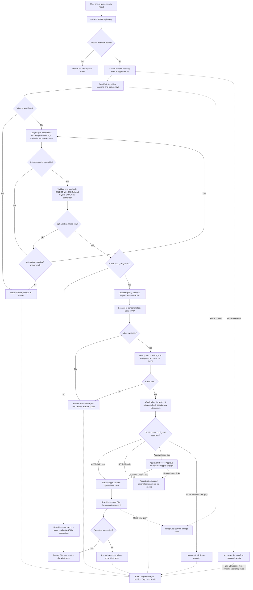

# Actual application flow

This diagram describes the current implementation in `src/text_to_sql`, including
the default approval-required path and the optional direct read-only path.

## What happens, step by step

1. **Submit and track.** React sends the question to FastAPI. The API accepts one
   active workflow at a time, creates a run in `approvals.db`, and starts the
   background workflow. A second question gets HTTP 429 while that run is active.
2. **Read the schema.** The app reads table and column information and foreign
   keys from `college.db`. It gives this schema and the question to the model;
   it does not send the database's rows to Ollama.
3. **Generate, evaluate, and validate.** Each Ollama request returns SQL plus a
   relevance self-check in the same response. If the question is not answerable,
   or the SQL fails local validation, LangGraph retries with the feedback. There
   are at most three total generation requests. SQLGlot and SQLite independently
   check that the statement is a single, read-only query before approval.
4. **Choose execution mode.** With `APPROVAL_REQUIRED=false`, the validated SQL
   is executed immediately using a read-only SQLite connection. With
   `APPROVAL_REQUIRED=true`, the query is not executed yet.
5. **Request approval.** The app creates an expiring request, connects to the
   sender's inbox using IMAP, and sends the question and SQL to `APPROVER_EMAIL`
   using SMTP. If inbox setup or email delivery fails, the workflow reports the
   failure and does not execute the query.
6. **Wait for the approver.** For up to 20 minutes, the app checks the sender
   mailbox about every 15 seconds. Only a reply from the configured approver
   matching the request ID is considered. The reply must start with `APPROVE`
   or `REJECT`; text after it is saved as an optional comment. The emailed
   approval link can also be used to approve or reject. The link is a bearer
   secret: anyone who has it can make that request's decision.
7. **Execute only on approval.** An approval causes the backend to validate the
   saved SQL again and execute it read-only. Rejection, expiry, email failure,
   and validation/execution failure do not return query results. The tracker
   records the SQL, outcome, approver, comment, and results where applicable.
8. **Show progress.** Workflow events are persisted in `approvals.db`. React
   receives updates over one Server-Sent Events connection and displays the
   current stage, generated/executed SQL, approval outcome, comments, and results.

## Example: average salary in the AI department

For the question **“What is the average salary of employees in the AI department?”**:

1. The schema tells the model which employee salary and department fields exist
   and how those tables relate.
2. Ollama proposes a `SELECT` that calculates the average salary for the matching
   department and returns its relevance assessment.
3. The app checks the SQL locally. If it is unsafe, invalid, or judged irrelevant,
   it retries (up to three model calls total).
4. With approval enabled, the app emails the validated SQL and waits. The query
   only runs after the configured approver approves by email reply or approval
   page. With approval disabled, it runs immediately, still read-only.
5. The app displays the result and records the outcome in the tracker.

**Important:** LLM relevance self-checking is not proof that a query's meaning is
correct. Review the question and SQL before approving. The app's read-only
protections are intended to prevent database writes; keep backups of important
data as with any application.
