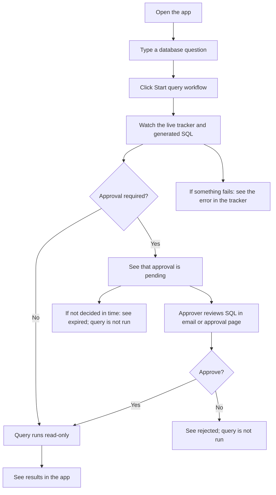

# Frontend flow

## In simple words

1. Open the frontend and type your question.
2. Click **Start query workflow**. The tracker shows the steps and SQL as they
   happen. You can also expand **Explore database schema** to see the tables.
3. If approval is **off**, the query runs read-only and the results appear.
4. If approval is **on**, the app says it is waiting. The approver reviews the
   email or approval page:
   - **Approve:** the query runs read-only and results appear.
   - **Reject:** the query is not run; the tracker shows the decision and comment.
   - **No decision before expiry:** the query is not run.
5. If generation, validation, email, or execution fails, the tracker displays
   the error.

The browser receives tracker updates over a single live connection. It does not
send a new status request every few seconds.
